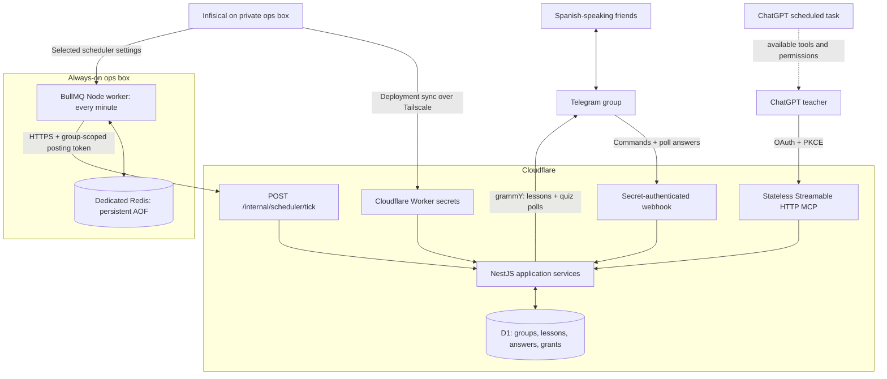

# Telegram Russian Teacher

A **TypeScript + NestJS** backend on **Cloudflare Workers + D1**. ChatGPT is the teacher: it writes Russian lessons for Spanish-speaking friends and submits them through an authenticated MCP connection. The backend stores content, publishes Telegram messages/quizzes at the scheduled time, and records quiz progress.

**There is no OpenAI API integration or API key in this version.** No autonomous content generation runs on the backend. ChatGPT routines can prepare lessons in advance; BullMQ on the ops box triggers Cloudflare to deliver content already saved in D1.

## Architecture



Nest runs as a standalone application context in Cloudflare with providers and dependency injection. The native `fetch` handler invokes those services. A separate Node process on the ops box runs BullMQ with Redis and calls an authenticated, group-scoped delivery endpoint every minute. Cloudflare Cron Triggers are disabled. [Nest standalone applications](https://docs.nestjs.com/application-context), [BullMQ Job Schedulers](https://docs.bullmq.io/guide/job-schedulers), [grammY Workers hosting](https://grammy.dev/hosting/cloudflare-workers-nodejs).

## ChatGPT MCP and routines

An MCP connection gives ChatGPT tools to manage this backend. It does not give Telegram members access to your ChatGPT account, subscription, project, or conversation history. Their group receives lessons and quizzes; free-form AI replies are outside this MVP.

Official documentation describes [scheduled tasks using connected tools](https://learn.chatgpt.com/docs/automations) and [OAuth-authenticated MCP connections](https://developers.openai.com/plugins/build/auth). Availability and unattended write approvals depend on your ChatGPT surface, account, workspace policy, and tool permissions. Test one scheduled run in the actual account before relying on it. The repository cannot activate account features or bypass approval requirements.

BullMQ delivery is independent of ChatGPT: it publishes pending D1 entries while the ops scheduler and Cloudflare are running, even when your computer and ChatGPT are closed. If a ChatGPT routine fails, existing scheduled content still posts, but new lessons will not be created. Have ChatGPT prepare several days ahead for continuity. Group `lesson_time` and `quiz_time` are preferences for the teacher/routine; they do not create recurring content themselves.

## Requirements

- Node.js 24 LTS and npm (Node >=22 supported by the application tooling).
- A Cloudflare account with Workers and D1 available.
- An always-on Node.js host with Docker Compose and a dedicated Redis instance for BullMQ.
- A Telegram bot from BotFather and a group you administer.
- An MCP-capable client. For ChatGPT use a custom connection with a predefined OAuth client.
- Infisical CLI and access to your existing instance for the recommended secret workflow.

## Local development

```sh
npm ci
cp .dev.vars.example .dev.vars
# Replace local-only values in .dev.vars. Never commit them.
npm run db:local
npm run check
npm test
npm run dev
```

Use a **separate development bot** if testing Telegram locally. Telegram needs a public HTTPS webhook; localhost health and MCP can be tested without one. For local delivery, run the BullMQ process separately with `PUBLIC_BASE_URL=http://localhost:8787`, a local `REDIS_URL`, and a local `SCHEDULER_GROUP_TOKEN`. See [scheduler operations](docs/scheduler.md).

```sh
curl http://localhost:8787/health
npm run admin -- group -1001234567890 "Ruso para amigos" Europe/Madrid
npm run admin -- token -1001234567890
```

IDs above are examples. Use the actual group ID. All admin commands target local D1 unless `--remote` is supplied. The token command shows the new group token **once**, intentionally; save it in Infisical and avoid logging the command output in CI. The database stores only its SHA-256 hash.

Tests run the bundled Nest application inside the actual local Workers runtime with isolated D1 and mocked external Telegram traffic. They never use live tokens or send real messages.

## Cloudflare deployment

```sh
npx wrangler login
npx wrangler d1 create russian-teacher
```

Copy the returned `database_id` into `wrangler.toml`. The all-zero ID is a local placeholder. Set an appropriate Worker name, then:

```sh
npm run db:remote
npm run deploy
```

This initial deployment provisions the Worker before uploading settings; no groups exist and nothing can post. Record its HTTPS URL. Upload the configuration below, then run deployment again if needed. No GitHub workflow deploys automatically.

### Settings and secrets

Store **all application settings in Infisical**, preferably in a dedicated project/environment/path. The repository contains only example values. `wrangler.toml` has no secret values and no production `[vars]` that would conflict with secrets of the same name.

| Key | Purpose |
| --- | --- |
| `TELEGRAM_BOT_TOKEN` | BotFather credential |
| `TELEGRAM_WEBHOOK_SECRET` | Independent random secret, 32+ characters; Telegram allows A–Z, a–z, 0–9, `_`, `-` |
| `PUBLIC_BASE_URL` | Canonical public Worker HTTPS origin, no path or trailing slash |
| `OAUTH_CLIENT_ID` | Predefined public OAuth client identifier, e.g. `russian-teacher-chatgpt` |
| `OAUTH_REDIRECT_URIS` | JSON array of exact callback URI(s) displayed in the MCP client's setup |
| `OAUTH_SIGNING_SECRET` | Independent random 32+ character secret for signed authorization forms |

Generate random secrets with a password manager or `openssl rand -hex 32`. Store the group access token separately in Infisical; it is not a Worker environment setting.

### Infisical on your Tailscale ops box

Run the commands from the ops box, or another authenticated machine that can reach the private Infisical instance. Use its self-hosted API domain and the correct project/environment/path. The CLI must already be authenticated; no Infisical machine credentials belong in this repository. Check `infisical --help` for your installed CLI version. Current CLI documentation: [Infisical run](https://infisical.com/docs/cli/commands/run).

```sh
# After cloning this repository on your ops machine and authenticating both CLIs:
infisical run --domain=https://YOUR_INFISICAL_HOST --projectId=YOUR_PROJECT_ID --env=prod --path=/russian-teacher -- npm run secrets:sync
infisical run --domain=https://YOUR_INFISICAL_HOST --projectId=YOUR_PROJECT_ID --env=prod --path=/russian-teacher -- npm run webhook
```

`secrets:sync` allows only the six application settings above and pipes them directly into Wrangler's secret bulk upload. It does not print values, put them into command arguments, or write an intermediate secrets file. Cloudflare's deployment credential stays in the ops environment and is not copied into the Worker.

Infisical remains the source of truth. Worker secrets are runtime copies and must be synchronized again after rotation. Public Cloudflare Workers cannot directly reach your private Tailscale network in this setup; the ops machine performs the sync. Do not expose Infisical publicly just for the bot.

### This project's direct Infisical connection

The non-secret project coordinates are saved in `config/infisical.json`: project
`f51da42d-632d-4516-9a98-3fb013479426`, environment `prod`, root folder `/`.
The direct API helper needs no additional CLI installation.

Create a dedicated **Viewer** machine identity for this project with **Universal Auth**.
Restrict it to `prod` and `/` if your instance supports environment/path policies.
Keep its client secret out of the repository and out of chat. On the deployment Mac,
create `.local/infisical-credentials.json` with this structure and permissions `600`:

```json
{"clientId":"YOUR_MACHINE_CLIENT_ID","clientSecret":"YOUR_MACHINE_CLIENT_SECRET"}
```

```sh
npm run infisical -- check
npm run infisical -- sync
npm run infisical -- webhook
```

The helper authenticates to the configured private Infisical endpoint, reads this
project/environment/folder only, validates the six app settings, and passes them
in memory to the existing deployment scripts. It does not print their values or
persist copies. `TELEGRAM_GROUP_ID` may also be present for setup; the Worker sync
still accepts only the six runtime settings. Authentication credentials are never
uploaded into the Worker. Tailscale and Wrangler login must be active on this Mac.

### Register the Telegram group

1. Add the bot to your group. Allow it to send messages and polls. Making it an administrator makes Telegram membership/admin checks reliable. Privacy mode can stay enabled: only commands and the bot's poll answers are needed.
2. After setting the webhook, a group administrator can send `/chatid@YourBotUsername` to obtain the negative group ID.
3. Register it and issue a scoped token:

```sh
npm run admin -- group -1001234567890 "Ruso para amigos" Europe/Madrid --remote
npm run admin -- token -1001234567890 config:read,config:write,lessons:read,lessons:write,lessons:post,progress:read 90 --remote
```

For automated setup, keep the issued MCP token out of logs by adding
`--out .local/mcp-group-token.json` to the token command. This creates a private,
non-overwriting JSON file suitable for importing `MCP_GROUP_TOKEN` into Infisical.
It is not one of the six Worker runtime settings.

Group registration requires trusted D1 operator access. A chat member cannot register arbitrary groups or acquire MCP credentials through Telegram. Groups start **paused**. OAuth does not grant access to a group just because a caller supplies its ID.

### Connect ChatGPT through MCP

1. Use `https://YOUR_WORKER/mcp` as the MCP server URL.
2. Choose OAuth and a **predefined public client**, with `OAUTH_CLIENT_ID` as the client ID and token endpoint authentication method `none`. There is no OAuth client secret; PKCE S256 is required. This MVP does not offer dynamic client registration or CIMD. A client that requires those methods needs an adapter added later.
3. Copy the exact callback URI shown in the connection setup into `OAUTH_REDIRECT_URIS` in Infisical and sync it. Do not guess the callback or add wildcard redirects.
4. Connect. On this backend's authorization page, enter the group access token issued above. The requested permissions must all exist on that token. Never paste your Telegram token, Infisical token, or another service credential into that page.
5. Ask ChatGPT to call `get_group_config` for your actual group ID, then `update_group_config` with `{"enabled":true}` when ready.
6. Test an authored lesson scheduled a few minutes ahead and check `list_lessons` for `sent`.

Discovery endpoints: `/.well-known/oauth-protected-resource/mcp` and `/.well-known/oauth-authorization-server`. Access tokens expire in one hour (or earlier with their parent grant). Rotating refresh tokens last up to 30 days, bounded by the parent grant. Revoking the original group token invalidates its derived access and refresh credentials. Reconnect after expiration or revocation.

Bearer-authenticated clients can also use the issued group token directly in the Authorization header. Never put credentials in URLs.

## MCP tools

Every tool requires `group_id`, checks its match with the credential, and checks the specific scope. Tools without the credential's scope are omitted from its tool list.

| Tool | Scope | Behavior |
| --- | --- | --- |
| `get_group_config` | `config:read` | Read group times, timezone, level, paused state |
| `update_group_config` | `config:write` | Update timezone, times, level, or enabled state |
| `schedule_lesson` | `lessons:write` | Save authored lesson/quiz for an explicit timestamp |
| `list_lessons` | `lessons:read` | Latest 50 lesson states and message IDs |
| `get_lesson` | `lessons:read` | Read saved lesson/quiz content for follow-up teaching |
| `post_lesson` | `lessons:post` | Move an existing pending lesson to the next BullMQ delivery tick |
| `get_progress` | `progress:read` | Group or individual aggregate quiz results |

`schedule_lesson` parameters:

```json
{
  "group_id": "-1001234567890",
  "kind": "lesson",
  "topic": "saludos y presentaciones",
  "publish_at": "2026-10-20T10:00:00+02:00",
  "idempotency_key": "routine:2026-10-20:lesson",
  "content": {
    "title": "¡Tu primera conversación en ruso!",
    "text": "Привет! — ¡Hola!\nPronunciación aproximada: priviét.\nПривет, Мария! — ¡Hola, María!\n\nEjercicio: saluda a un amigo en ruso."
  }
}
```

For `kind: "quiz"`, content has `question`, exactly four `options`, zero-based `correct_option` (0–3), and `explanation` in Spanish. Explanation is a single line. Native quizzes stay open for ten minutes and are non-anonymous so answers can be scored. Bounds are validated before saving or posting. There is no arbitrary Telegram API proxy.

Timestamps require an explicit UTC offset or `Z`. Schedule at most 366 days ahead. Reuse an idempotency key for retries; it identifies one lesson within one group. A different topic, kind, or content with the same key is rejected. Existing schedules keep their absolute timestamps when group timezone preferences change.

## Teaching and routines

See [teacher prompt](docs/teacher-prompt.md) and [routine setup](docs/routines.md). The audience speaks Spanish and is learning Russian, starting at A1. Explanations, translations, and pronunciation help are in Spanish. Russian expressions retain Cyrillic.

Create routines only after the MCP connection works. No routine is created by deploying this repository. Use the scheduled task's actual connected tools and permissions. The routine should prepare content ahead of its publication time and use a stable date-based idempotency key. The backend never creates another daily lesson on its own.

## Reliability and operations

- BullMQ calls the scoped delivery endpoint every minute, which scans due D1 entries, processes up to three per invocation, and checks group enabled state again before sending. Posting can lag by a minute or longer under backlog/platform delays. Redis outages or an offline ops host pause delivery until recovery; D1 retains pending lessons.
- Atomic D1 claims and a unique `(group_id, dedupe_key)` prevent concurrent delivery of the same pending lesson. Preparation claims have two-minute leases and bounded retries.
- Once a Telegram send begins, an interrupted/failed call becomes `uncertain` instead of being automatically repeated. Telegram does not provide an idempotency key for sendMessage/sendPoll. A network timeout can mean the message arrived. Exactly-once delivery across Telegram and D1 is not claimed.
- Inspect Telegram before manually retrying a failed/uncertain lesson:

```sh
npm run admin -- retry LESSON_UUID --checked-telegram --remote
```

- `/progress` shows a member their own score; MCP can read aggregate results or filter to a specified user within its group. `/forget` deletes the caller's saved answers in that group. `/help` explains storage. New quiz answers can be recorded again after deletion.
- Persist only Telegram numeric user IDs and poll choices/correctness, not names or general chat history. Webhook replay records expire after seven days. Lesson/answer data remain until deleted; choose your retention policy before broader use. The `updated_at` value on answer rows is the Telegram update sequence used for ordering.
- Incoming webhooks require the separate Telegram secret. Requests are bounded to 32 KiB. MCP verifies authorization on every request and tool call. SQL values use prepared statements. Tokens and codes are stored hashed; consent forms are signed and restricted to same-origin submission. Redirects and OAuth resource are exact-matched.
- OAuth is intended for a private, small group MVP with operator-issued group grants. Add identity-provider login, distributed login throttling, and audit retention before opening public self-service registration.
- Logs contain event/error codes and lesson IDs, not request bodies, credentials, Telegram token-bearing URLs, or raw upstream exceptions.
- `npm run admin -- revoke SHA256_HASH --remote` revokes a group grant and cascades to derived credentials. Rotate webhook/signing secrets in Infisical and synchronize; re-register the Telegram webhook after changing its secret.

## Repository map

- `src/worker.ts`: native Workers HTTP, webhook, OAuth, MCP, and scoped delivery endpoint
- `src/app.module.ts`: standalone Nest module and provider graph
- `src/mcp.ts`, `src/auth.ts`, `src/oauth.ts`: tools, scopes, authentication, OAuth
- `src/store.ts`: D1 group, schedule, and progress operations
- `src/scheduler.ts`, `src/telegram.ts`: durable delivery and Telegram updates
- `src/queue-runner.ts`: BullMQ repeating job producer and consumer on the ops box
- `compose.scheduler.yml`, `Dockerfile.scheduler`: isolated Redis and scheduler deployment
- `docs/scheduler.md`: scheduler settings, operations, rotation, and recovery
- `migrations/`: D1 schema and OAuth grant tables
- `scripts/`: build, group/token administration, webhook registration, Infisical-to-Workers sync
- `test/`: isolated Workers/D1 integration checks
- `docs/architecture.md`: implementation and schema diagrams

The CI workflow checks TypeScript, builds the Worker, runs isolated integration tests, and audits production dependencies. Deployment remains an explicit operator command.
