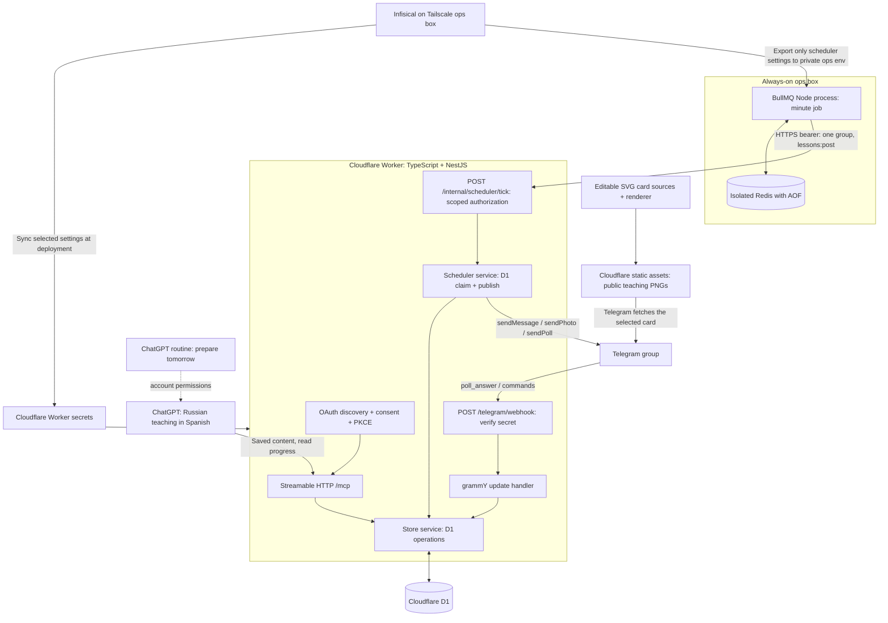
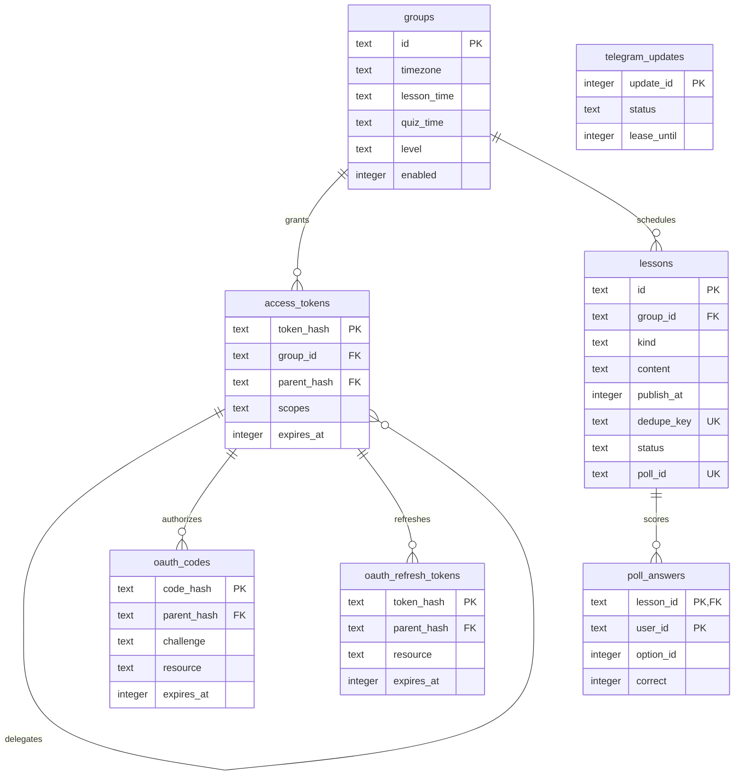
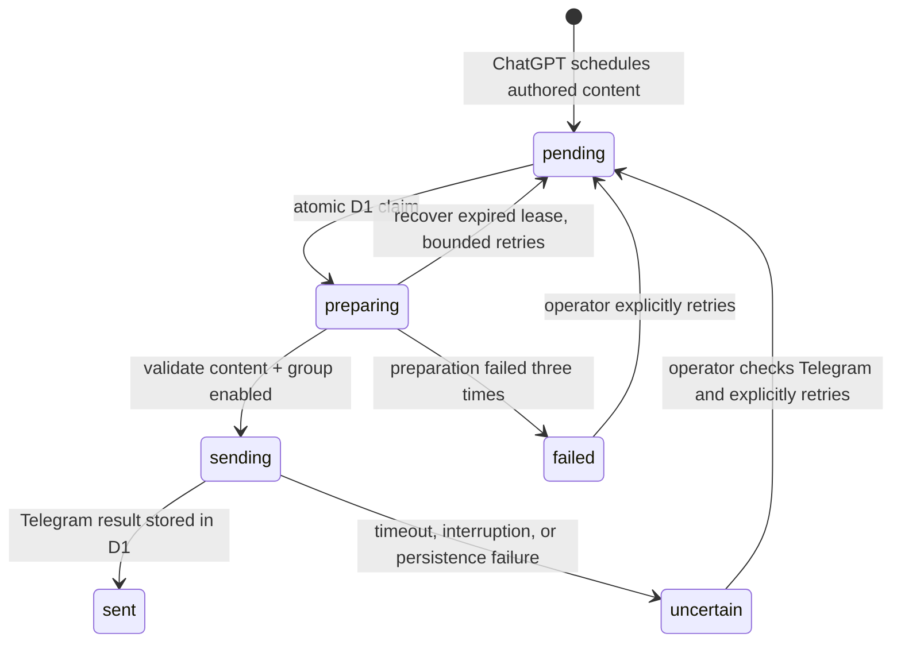

# Implementation map

There is no model API in this implementation. Tailscale is used to reach Infisical from the deployment machine, not by the running Worker. MCP account permissions and ChatGPT scheduled-task support are separate from BullMQ delivery. Cloudflare Cron Triggers are disabled. Redis holds recurring trigger jobs, while D1 is the source of truth for authored content, publication times, delivery leases, and results. The Cloudflare Worker never connects to Redis or to the private ops network. See [scheduler operations](scheduler.md).

## Lesson images

Public teaching cards are deployed with Workers Static Assets from `public/`.
The D1 lesson content JSON stores an optional allowlisted `image_path`; no schema
migration or new secrets are needed. The scheduler resolves it against the
configured public base URL and uses one `sendPhoto` call with the full lesson
caption. Captions are validated at 1024 Unicode characters including the title.
Arbitrary external URLs and paths are rejected. Photo sends use the same atomic
claims and uncertain-delivery protection as text lessons. Quizzes remain native
Telegram polls. Group-private data and credentials must never enter public assets.
See [media operations](media.md).

## Database relationships

The lesson deduplication constraint covers `(group_id, dedupe_key)`. Poll-answer primary keys cover `(lesson_id, user_id)`. Telegram replay records are independent of group data and retain only update IDs and processing state.

## Delivery states

## Scheduling ownership and failures

ChatGPT routines author content and call MCP. BullMQ's stable `delivery-every-minute` Job Scheduler produces delivery ticks using a UTC cron expression. The consumer calls Cloudflare with an expiring token restricted to `lessons:post` and one group. No content, BotFather token, or OAuth signing secret is put in Redis. For additional groups, run a separate Compose project and Redis volume with that group's posting token.

Each successful tick processes at most three due lessons. Group-enabled checks and atomic D1 leases apply to every delivery. BullMQ retries failed tick requests up to three times with exponential backoff; a Telegram send with an unknown outcome remains `uncertain` in D1 and cannot be resent by another tick. Operator review is required before retrying it. Redis AOF preserves recurring jobs across restarts; restarting the runner also upserts the same scheduler ID without adding a second schedule. An ops outage pauses delivery; overdue D1 entries are picked up when ticks resume.
