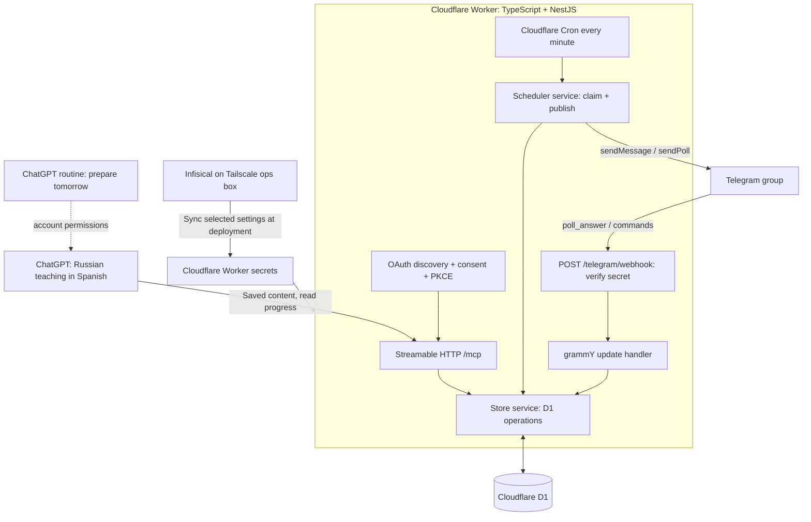
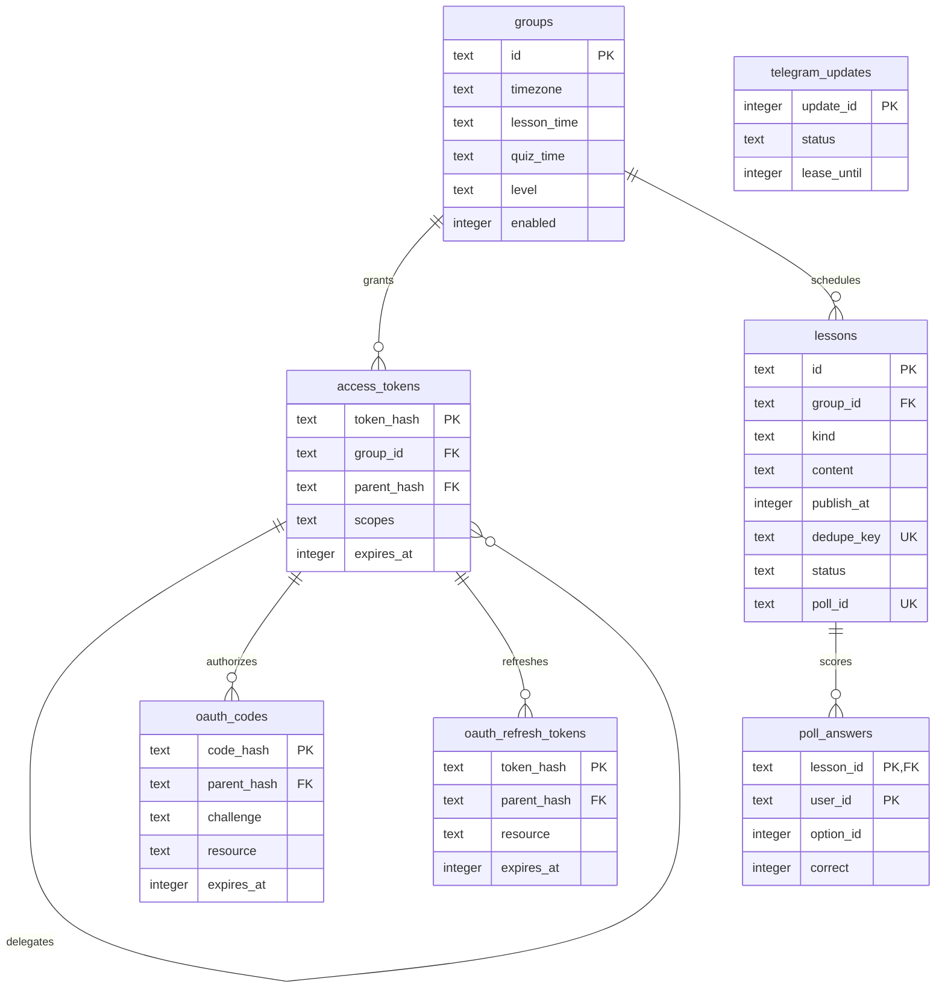
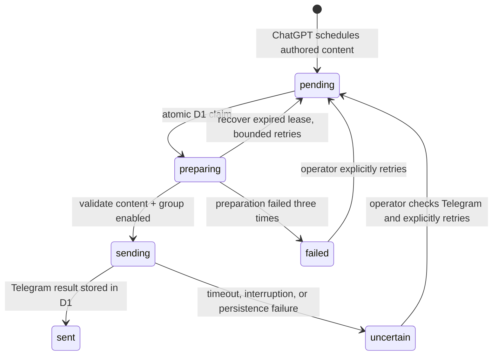

# Implementation map

There is no model API in this implementation. Tailscale is used to reach Infisical from the deployment machine, not by the running Worker. MCP account permissions and ChatGPT scheduled-task support are separate from Cloudflare's delivery cron.

## Database relationships

The lesson deduplication constraint covers `(group_id, dedupe_key)`. Poll-answer primary keys cover `(lesson_id, user_id)`. Telegram replay records are independent of group data and retain only update IDs and processing state.

## Delivery states

